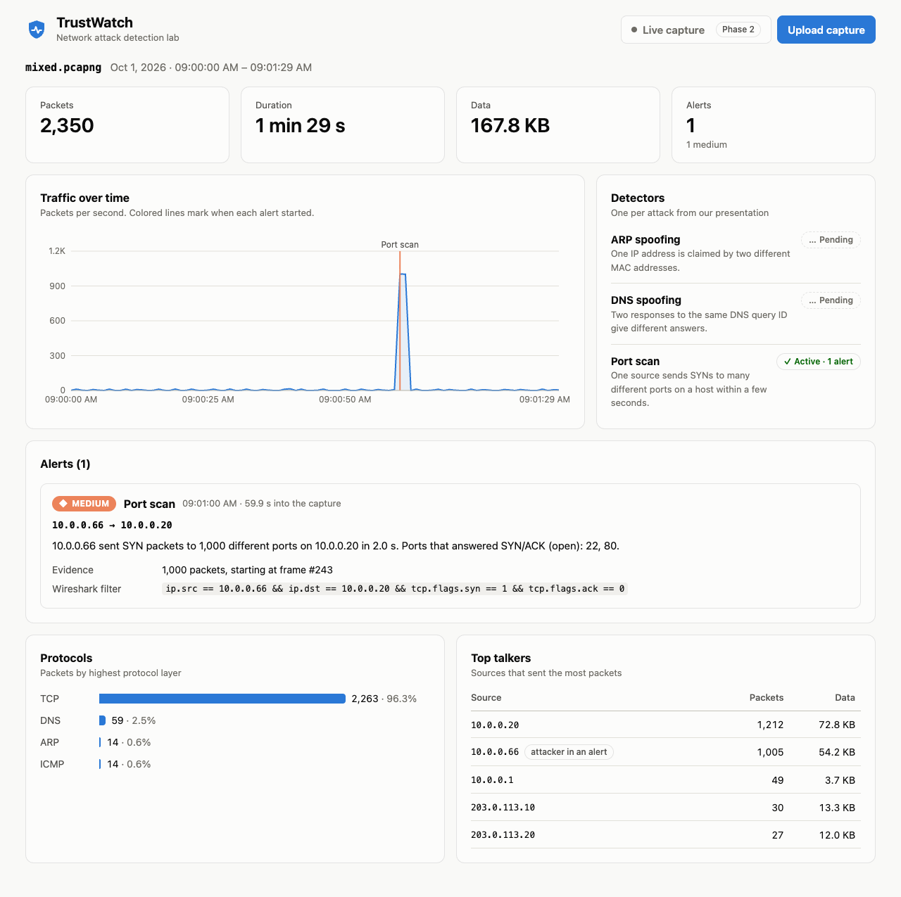

# TrustWatch: Network attack detection lab

Upload a Wireshark capture (`.pcap` / `.pcapng`) and TrustWatch flags the three attacks from our presentation: **ARP spoofing**, **DNS spoofing** and **port scanning**. Each alert points to the exact frames and gives a Wireshark display filter, so you can verify it in Wireshark.

Phase 2 adds live capture: the same detectors running on traffic as it happens.

> *Each of these attacks works because the protocol trusts by default. TrustWatch shows what that broken trust looks like in a packet capture.*



---

## Project plan

| Phase | Part | What | Owner | Doc |
|---|---|---|---|---|
| 1 | 1 | Scaffold: upload, engine, port scan detector, dashboard | | this README |
| 1 | 2 | ARP + DNS spoofing detectors, real lab captures | | [docs/phase1-part2-detectors.md](docs/phase1-part2-detectors.md) |
| 2 | 1 | Live capture backend: sniffing, streaming, saved sessions | | [docs/phase2-part1-live-backend.md](docs/phase2-part1-live-backend.md) |
| 2 | 2 | Live dashboard, alert explanations, validation, demo | | [docs/phase2-part2-live-dashboard.md](docs/phase2-part2-live-dashboard.md) |

**Phase 1 Part 1 status:** done. Upload works end to end, the port scan detector is finished and tested, and ARP/DNS are stubs that show as *Pending* on the dashboard.

---

## Run it

Needs **Python 3.10+** and **Node.js 20.19+** (built with Python 3.14 and Node 25).

**Terminal 1: backend** (API on port 8000)
```bash
cd backend
python3 -m venv .venv
.venv/bin/pip install -r requirements.txt        # Windows: .venv\Scripts\pip install -r requirements.txt
.venv/bin/uvicorn app.main:app --reload --port 8000
```

**Terminal 2: frontend** (dashboard on port 5173)
```bash
cd frontend
npm install
npm run dev
```

Open **http://localhost:5173** and drop in `backend/samples/mixed.pcapng`.

### Tests
```bash
cd backend
.venv/bin/python -m pytest
```

### Sample captures
`backend/samples/` holds synthetic captures that mirror our lab (gateway `10.0.0.1`, victim `10.0.0.20`, attacker `10.0.0.66`). Rebuild them any time:
```bash
cd backend
.venv/bin/python scripts/make_samples.py
```
The script only **writes files**. It never sends packets on a network.

| File | Contains |
|---|---|
| `baseline.pcap` | Normal traffic only: ARP, DNS lookups, HTTPS, pings |
| `port_scan.pcap` | Baseline + a 1,000-port SYN scan (ports 22 and 80 open) |
| `arp_spoof.pcap` | Baseline + forged ARP replies claiming the gateway's IP |
| `dns_spoof.pcap` | Baseline + a forged DNS answer racing the real one |
| `mixed.pcapng` | All three attacks: ARP at ~15 s, DNS at ~40 s, scan at ~60 s |

Real captures from the VirtualBox lab go in `backend/samples/lab/` (Phase 1 Part 2).

---

## How it works

```
 .pcap / .pcapng ──► Scapy reads each packet ──► PacketInfo (plain fields)
                                                      │
                                Engine.process(pkt) ──┼──► ARP spoofing detector
                                                      ├──► DNS spoofing detector
                                                      ├──► Port scan detector
                                                      └──► Traffic stats
                                                      │
                                Engine.result() ──► JSON ──► React dashboard
```

- **One engine for files and live traffic.** Detectors see one packet at a time and use packet timestamps, so Phase 2 can feed live packets into the same code.
- **One attack = one alert.** A detector returns an alert once, then keeps updating it (more evidence, later end time) while the attack continues.
- **Frame numbers match Wireshark's "No." column**, so "starting at frame #243" means frame 243 in Wireshark too.

### Folder layout

```
backend/
  app/
    main.py                 HTTP API: /api/health, /api/detectors, /api/analyze
    engine/
      packet.py             Scapy packet → PacketInfo
      detector.py           Detector base class + Alert
      engine.py             Runs detectors + stats; analyze_file()
      stats.py              Totals, protocols, top talkers, timeline
    detectors/
      port_scan.py          Done (Phase 1 Part 1)
      arp_spoof.py          Stub (Phase 1 Part 2)
      dns_spoof.py          Stub (Phase 1 Part 2)
  scripts/make_samples.py   Builds the synthetic sample captures
  samples/                  Sample captures
  tests/                    pytest
frontend/
  src/
    App.tsx                 Header, upload flow
    api.ts, types.ts        Backend calls + JSON types
    components/             Dashboard, chart, alerts, detectors, tables
docs/                       Hand-off docs for each part
```

---

## Safety and scope

From our project rules: every attack runs **only between our own VMs on an isolated host-only network**, with no path to the internet or campus network. The deliverable is the **detection tool**, not the attacks.
